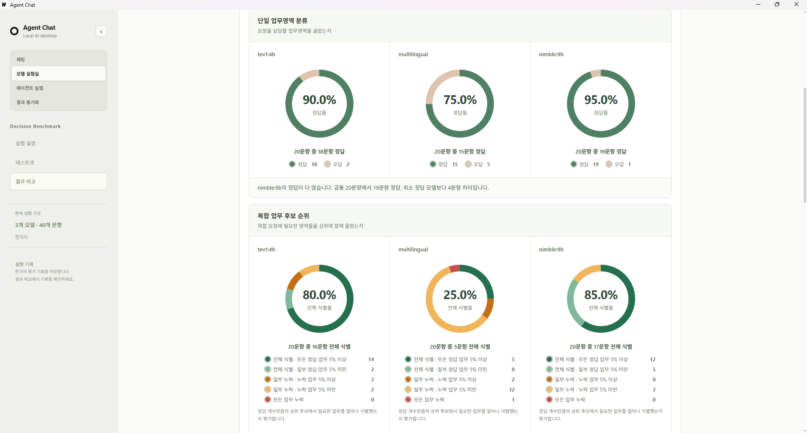
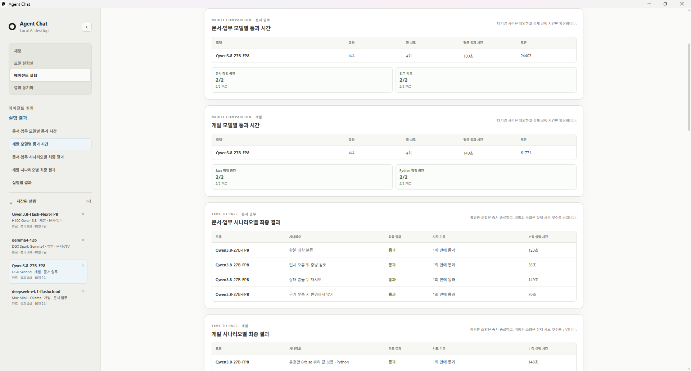

# Agent Chat Desktop

로컬 또는 원격의 OpenAI 호환 AI 서버와 연결하는 Wails 데스크톱 채팅 클라이언트입니다. 연결 프로필, 문서 첨부, 모델 벤치마크와 결과 비교를 제공합니다.

## 주요 기능

- OpenAI 호환 API·vLLM 서버 연결, 추론 강도 선택과 스트리밍 채팅
- 텍스트·코드·텍스트 기반 PDF·Word(`.docx`)·Excel(`.xlsx`) 첨부 내용을 참고하는 대화
- 긴 문서의 제목·시트·문단 단위 선택과 질문 관련 문맥 전달
- 출력이 이어지는 동안 유지되는 스트리밍 채팅과 생성 중단
- 연결 프로필과 모델별 응답 시간·토큰 사용량 확인
- 질문지 프로필 기반 모델 벤치마크, 누적 결과, 최대 세 기록 비교, 결과 창·분석·비교 화면의 Markdown·HTML 보고서 내보내기와 중복을 제외한 가져오기
- Decision API 기반 한국어 업무영역 평가(단일 분류·복합 업무 후보 순위), 모델별 도넛 그래프와 문항별 판단 분석, 독립 HTML 보고서
- 가상 문서·업무·개발 환경의 에이전트 실험, 느린 로컬 모델용 시간 설정과 미통과 사유별 행동·상태 변경 확인
- 일회용 코드 승인 후 수동 동기화하는 같은 네트워크의 벤치마크·에이전트 실험 결과 동기화
- Markdown 기반의 로컬 대화·벤치마크 기록 저장

## 화면 미리보기

### 채팅

### 모델 실험실

### 실무·개발 비교

문서·한국어 실무와 개발·지시 이행의 네 문항씩, 총 8개 결과를 같은 화면에서 비교합니다. 측정값은 상대 비교와 실제값으로 전환할 수 있으며, 응답 시간·첫 토큰 시간·생성 속도·출력 토큰을 각각 확인할 수 있습니다.

### Decision Benchmark

단일 업무영역 분류와 복합 업무 후보 순위 결과를 모델별로 함께 비교합니다.

### 에이전트 실험

문서·업무와 개발 시나리오의 모델별 통과 시간, 시나리오별 최종 결과와 저장된 실행 기록을 확인합니다.

## 빠른 시작

소스에서 실행하려면 Git, Go 1.25 이상, Node.js 20.19 이상 또는 22.12 이상이 필요합니다. macOS에는 Xcode Command Line Tools, Linux에는 GTK4·WebKitGTK 6.0 개발 패키지가 추가로 필요합니다.

| 운영체제 | 최초 준비 | 개발 실행 | 빌드 | 빌드 결과 실행 |
|---|---|---|---|---|
| macOS | `./scripts/macos/setup.sh` | `./scripts/macos/dev.sh` | `./scripts/macos/build.sh` | `./scripts/macos/run.sh` |
| Windows PowerShell | `powershell -ExecutionPolicy Bypass -File .\scripts\windows\setup.ps1` | `powershell -ExecutionPolicy Bypass -File .\scripts\windows\dev.ps1` | `powershell -ExecutionPolicy Bypass -File .\scripts\windows\build.ps1` | `powershell -ExecutionPolicy Bypass -File .\scripts\windows\run.ps1` |
| Linux | `./scripts/linux/setup.sh` | `./scripts/linux/dev.sh` | `./scripts/linux/build.sh` | `./scripts/linux/run.sh` |

macOS에서 DMG를 만들려면 `./scripts/macos/build.sh --dmg`를 사용합니다. Linux에서 설치 패키지까지 만들려면 `./scripts/linux/build.sh --package`, Windows에서 NSIS 설치 프로그램을 만들려면 `powershell -ExecutionPolicy Bypass -File .\scripts\windows\build.ps1 -Package`를 사용하세요.

스크립트는 프로젝트에 필요한 Wails CLI와 프런트엔드 의존성을 준비하고 환경을 검사합니다. 시스템 도구는 임의로 설치하지 않으며, 빠진 항목과 설치 방법을 알려 줍니다.

## 에이전트에게 맡길 때

에이전트로 설치·빌드·실행 작업을 맡기는 경우 다음 파일을 먼저 읽도록 지시하세요.

> `docs/agent-setup.md`

이 문서에는 운영체제별 필수 도구, 권한이 필요한 설치 작업, 스크립트 사용 순서, 검증 방법과 자주 발생하는 문제의 해결 절차가 정리되어 있습니다.

## 문서

- [에이전트 설치·빌드 안내](docs/agent-setup.md)
- [상세 아키텍처](docs/architecture.md)
- [로컬 모델 에이전트 실험 설계](docs/agentic-evaluation-design.md)
- [Decision Benchmark 구현 계획](docs/decision-benchmark-implementation-plan.md)
- [업무영역 질문 세트·평가 기준](docs/decision-benchmark-domain-question-set.md)
- [개발 진행 현황](docs/progress.md)
- [ANP 참고와 결과 동기화](docs/anp-benchmark-sync.md)

## Decision Benchmark

모델 실험실의 **Decision Benchmark**는 같은 요청을 여러 판단 모델에 전달해 단일 업무영역 분류와 복합 요청의 후보 순위를 비교합니다. 서버 프로그램은 **Ollama** 또는 **기타 Decision API 호환 서버**를 선택합니다. Laya 서버는 후자를 사용하며, 공통 호출 경로는 `POST /v1/systemone`입니다.

기본 세트는 업무영역 20종을 바탕으로 한국어 단일 20문항과 복합 20문항, 총 40문항입니다. 영어는 기본 제공 범위에 포함하지 않습니다.

| 평가 유형 | 문항 수 | 판단 내용 |
|---|---:|---|
| 업무영역 분류 (choice) | 20 | 요청을 담당하는 업무영역 하나 선택 |
| 복합 업무 후보 순위 (ranking) | 20 | 필요한 2~3개 영역이 상위에 함께 있는지 평가 |

1. **실험 설정**에서 실험 이름, 서버 프로그램과 기본 주소를 입력합니다. **모델 불러오기 / 목록 새로고침**으로 모델 목록을 가져와 선택합니다. Ollama 모델은 설치된 태그까지 정확히 사용합니다.
2. **연결 테스트**로 짧은 기본 API 요청의 응답을 확인합니다. 성공·실패와 오류 원인을 대상 카드에 표시합니다. 연결 성공은 평가 문항을 정확히 판단한다는 의미가 아닙니다.
3. **단일 업무영역 분류 / 복합 업무 후보 순위** 중 평가할 세트를 선택합니다. 질문 구성은 기본값으로 고정하며 요청 JSON 미리보기는 표시하지 않습니다. **테스트셋**에서 판단 기준과 문항을 확인하고 사용자 세트로 복제해 편집하거나 JSON·CSV로 가져올 수 있습니다.
4. **설정 확인**은 입력과 문항 구성을 검사하며, **벤치마크 실행**은 선택한 모델에 순차 요청을 보냅니다. 요청 제한은 기본 60초 또는 느린 서버 180초입니다. 유형별 준비 요청은 측정에서 제외하고, 준비가 실패한 유형만 미실행으로 남긴 뒤 다른 유형을 진행합니다.
5. **결과 비교**에서 공통 문항 기준의 모델 차이를 확인합니다. 단일 분류는 정답률을, 복합 업무 후보 순위는 전체 식별·확률 배분·누락을 나눈 도넛 그래프를 표시합니다. 문항은 모델·유형·결과로 필터링하고 행에서 바로 펼쳐 정답, 모델의 상위 후보, 확률과 평가 이유를 확인할 수 있습니다.

현재 기본 세트 버전은 **0.7.0-draft-compact / 0.7.0-draft-detailed**입니다. 업무영역 20종을 기준으로 단일 분류 20문항과 복합 후보 순위 20문항을 제공합니다. 평가할 본문에는 실제 요청만 넣습니다. 두 과제 모두 선택지에 업무 정의를 붙이고 서버에는 choice 질문으로 전달합니다. 복합 문항의 정답은 D04|D05처럼 저장하지만 모델 입력에는 정답과 정답 개수를 넣지 않습니다. 상위 K개(K는 정답 개수)의 전체 목록 일치율·정답 영역 회수율·NDCG@K를 중심으로 채점하고, 정답 영역 확률 합은 보조 지표로 사용합니다. 이는 모델이 필요한 업무 개수 자체를 맞히는 평가는 아닙니다. 이전 noul/score 기본 문항은 제외하고 새 평가 결과는 독립적으로 저장합니다. 이전 결과의 연동·가져오기·비교는 제공하지 않습니다. 기존 파일은 삭제하지 않습니다. 업무 설명 목록을 요청 본문에 합치던 이전 구성과 구분해 기록합니다. 문항별 질문은 화면, JSON·CSV의 `instructions` 열, 실행 기록과 보고서에 보존됩니다.

복합 업무 후보 순위의 도넛 그래프는 다음 다섯 결과를 함께 보여 줍니다. 후보가 20개이므로 기본 확률 배분 기준은 5%입니다.

| 결과 | 의미 |
|---|---|
| 전체 식별 · 모든 정답 업무 5% 이상 | 필요한 업무를 모두 상위 K개에 넣었고 각 업무에 5% 이상을 부여 |
| 전체 식별 · 일부 정답 업무 5% 미만 | 필요한 업무를 모두 상위 K개에 넣었지만 하나 이상에 5% 미만을 부여 |
| 일부 누락 · 누락 업무 5% 이상 | 필요한 업무 일부가 상위 K개에서 밀렸지만 빠진 업무에는 모두 5% 이상을 부여 |
| 일부 누락 · 누락 업무 5% 미만 | 필요한 업무 일부가 상위 K개에서 빠졌고, 빠진 업무 중 하나 이상에 5% 미만을 부여 |
| 모든 업무 누락 | 필요한 업무가 상위 K개 후보에 하나도 없음 |

가운데의 전체 식별률은 위 첫 두 항목의 합입니다. 확률을 확인할 수 없는 문항은 별도 회색 항목으로 표시하며, 각 문항은 하나의 항목에만 집계합니다.

**Markdown 저장 / HTML 저장**으로 단일 결과 또는 최대 3개 동일 조건 기록의 비교 보고서를 내보낼 수 있습니다. HTML은 그래프·비교 설명과 모델·유형·결과 필터, 문항 선택 상세를 포함하며 인터넷 연결 없이 열립니다. 문항 상세에서는 평가 세트의 정답 설명, 모델이 반환한 확률, 앱이 구성한 상위 후보와 평가 결과를 구분해 보여 줍니다. 복원용 원본 데이터도 포함하여 **보고서 가져오기**로 다시 읽을 수 있습니다. 질문 구성이나 채점 버전이 다르면 동일 조건 비교를 차단합니다.

미실행·오류·서버가 보고한 입력 잘림은 정답으로 채점하지 않습니다. 잘림을 보고하지 않는 서버는 미확인으로 표시합니다. API 키는 실행 중에만 사용하며 기록에 저장하지 않습니다. Decision 기록은 사용자 설정 폴더의 별도 `decision-benchmarks-v2` 영역에 보관합니다. 결과 동기화 메뉴의 전송 대상은 현재 생성형 벤치마크와 에이전트 실험이며 Decision 기록은 보고서로 옮깁니다.

기본 문항의 정답은 사람 검토 전 초안이고, 선택형은 영역당 한 문항입니다. 결과는 이 세트 안에서의 판단 정확도를 비교하는 자료이며 전반적인 업무 능력이나 자동 업무 배정의 신뢰성을 보장하지 않습니다. 서버의 선택지·전체 입력 길이 제한과 한국어 판단 성능도 다를 수 있습니다.

### 2026-10-14 작업 내용

- 초기 한국어 기본 세트와 선택형·해당 여부·적합도 채점, 순차 실행·취소·유형별 준비 실패 처리 추가
- 서버에서 모델 목록을 가져와 정확한 설치 태그를 선택하고 연결 결과를 명확히 표시
- 요청 본문과 업무 정의를 분리한 0.5 질문 구성, 세트 입출력과 문항별 질문 편집 적용
- 창 공간을 활용하는 테스트셋 목록·상세 배치와 결과 요약 그래프·오답 필터·설명이 있는 전문 지표 제공
- 독립 HTML 보고서, 단일·동일 조건 비교 내보내기·가져오기와 이전 기록 호환성 구현
- 서버 `usage`에 포함된 입력 잘림 정보 반영과 정답·인증 정보의 요청/기록 혼입 방지 검증

### 2026-10-15 작업 내용

- 기본 세트를 단일 업무영역 분류와 복합 업무 후보 순위의 독립된 2개 데이터셋으로 정리하고, 이전 기본 결과와 분리해 저장
- 복합 문항은 상위 K개 후보와 업무별 확률을 사용해 전체 식별·일부 누락·모든 업무 누락을 평가하고, 누락 업무의 확률 배분을 포함한 5개 도넛 항목으로 표시
- 결과 문항을 행 안에서 펼쳐 정답 설명, 모델 응답, 앱의 평가를 구분하고 HTML 보고서에도 같은 필터·문항 선택 흐름 적용
- HTML 보고서의 모델 카드 안내문 배치와 한글 표시를 정리하고, 오프라인에서도 읽기 쉬운 상세 표와 범례 제공

## 에이전트 실험

**에이전트 실험**은 로컬 모델이 제한된 가상 환경에서 정보를 찾고, 도구를 사용하고, 실제로 최종 상태를 만들 수 있는지 측정합니다. 호스트의 실제 파일·셸·네트워크·프로세스에는 접근하지 않습니다.

1. 연결 프로필을 고르고 API 키를 입력한 뒤 **모델 불러오기**를 누릅니다. API 키 입력칸에서 Enter를 누르는 것도 같은 동작입니다.
2. `문서·업무` 또는 `개발`에서 실행할 시나리오를 고릅니다. 각 묶음에는 네 개의 시나리오가 있으며, 개발 시나리오는 Python·Java의 버그 수정과 기능 구현을 포함합니다.
3. 추론 강도, 최대 시도 횟수와 **표준 / 느린 로컬 모델** 시간 프리셋을 선택합니다. 필요하면 **피드백 재시도**를 켜 이전 시도의 채점 사유를 다음 시도에 전달할 수 있습니다.
4. 시작하면 모델·시나리오 한 조합을 통과 또는 미통과 확정까지 처리한 뒤 다음 조합으로 넘어갑니다. 실패한 재시도는 대기열 끝으로 보내지 않으므로 문서·업무와 개발 실행이 섞이지 않습니다.

시간 제한은 첫 출력 대기와 출력 중단을 따로 확인합니다.

| 프리셋 | 첫 출력 대기 | 출력 중단 허용 | 시나리오 실행 1회 제한 |
|---|---|---|---|
| 표준 (기본) | 10분 | 1분 | 60분 |
| 느린 로컬 모델 | 15분 | 5분 | 120분 |

출력이 계속되면 요청을 유지하며, 실행 전체 제한은 행동 사이에서만 확인합니다. 한 실행에는 최대 24번의 행동을 허용하고 도구 호출, 완료 선언, 형식 오류 응답도 각각 한 행동으로 셉니다. 시간·행동 한도나 연결 오류로 종료되어도 작업 결과가 완료 조건을 충족하면 통과로 인정하며 종료 사유를 함께 표시합니다. 수동 취소와 입출력 크기 제한은 유지합니다.

독립 재시도는 새 변형의 깨끗한 가상 환경에서 다시 시도합니다. 피드백 재시도는 같은 초기 환경을 새로 만들고 이전 채점 요약만 추가로 전달합니다. 어느 방식도 이전 실행의 변경 파일이나 대화를 이어받지 않습니다.

개발 시나리오는 이슈 티켓, API 계약서, 공개 검사, 샘플·더미 파일을 읽기 전용으로 제공합니다. 모델은 대상 소스 파일만 수정할 수 있고, 대상 외 파일이나 더미 파일을 바꾸면 실패합니다. `run_tests`는 가상 저장소 소스의 특정 표현을 확인하는 공개 검사이며 실제 Python·Java 코드를 실행하지 않습니다. 최종 소스 내용 검사도 같은 제한이 있어 동등한 다른 구현을 놓칠 수 있습니다. 개발 채점은 필요한 파일 읽기, 대상 소스 작성, 검사 도구 호출과 최종 소스 내용 검사를 확인합니다. 결과는 묶음별로 분리해 표시하고 HTML·Markdown 보고서에는 시도 방식, 시도 횟수, 누적 시간과 첫 통과 시간을 보관합니다.

결과 화면의 왼쪽 사이드바에는 `문서·업무`와 `개발`의 모델별 통과 시간, 시나리오별 최종 결과, 실행별 결과로 바로 이동하는 목차를 표시합니다. 같은 사이드바의 **저장된 실행**은 기본으로 접혀 있으며, 제목을 눌러 펼치면 이전 기록을 열거나 삭제할 수 있습니다. 삭제 버튼 `×`를 누르면 앱 내부 확인창에서 **삭제 확인** 또는 **취소**를 선택합니다. 실행 중에는 삭제할 수 없습니다. 이 펼침 상태는 앱을 다시 열어도 유지합니다.

실행별 결과는 **작업 평가 통과 / 미통과 / 평가 불가**로 구분하며, 마지막 시도가 진행 중이면 요약표도 **실행 중**으로 유지합니다. 결과 파일의 형식 오류·항목 누락·판정 불일치와 업무 기록의 잘못된 처리 상태를 구체적으로 설명하고, 채점하지 못한 경우에는 사유를 표시합니다.

새 측정 결과의 미통과 사유에는 **관련 행동 / 상태 변경 보기** 버튼을 제공합니다. 누르면 접힌 기록을 펼쳐 해당 항목으로 이동하며, 기록에도 관련 사유 번호를 표시합니다. 호출이나 변경이 없으면 그 사실을 설명합니다. HTML·Markdown 보고서에도 관련 기록 번호를 포함합니다.

## 로컬 AI 서버 연결

1. vLLM 등 OpenAI 호환 API 서버를 실행합니다.
2. 앱에서 서버 URL과 필요한 경우 API 키를 입력합니다.
3. **모델 불러오기**로 모델을 선택합니다.
4. 채팅을 시작하거나 **모델 실험실**에서 저장된 연결 프로필로 벤치마크를 실행합니다.

대화와 벤치마크 결과는 사용자 설정 폴더에 Markdown 파일로 저장됩니다. API 키는 저장하지 않습니다. 벤치마크 보고서를 다시 가져오면 같은 결과는 저장하지 않고, 여러 결과 중 새 결과만 추가합니다.

완료된 **벤치마크 결과** 창의 오른쪽 위 **내보내기** 메뉴에서 HTML 보고서 또는 Markdown을 바로 저장할 수 있습니다. 모델 실험실 홈의 기록 분석·기록 비교·실무·개발 비교 화면에서도 같은 형식으로 내보낼 수 있습니다. 기본 파일명은 환경 이름을 제외하고 다음처럼 구성합니다. 파일 시스템에서 허용하지 않는 문자는 공백으로 바꿉니다.

- 단일 결과: `benchmark_[모델]__[추론 강도]__[질문지].[html|md]`
- 두 기록 비교: `benchmark_[A 모델]_vs_1other__[추론 강도]__[질문지].[html|md]`
- 세 기록 비교: `benchmark_[A 모델]_vs_2others__[추론 강도]__[질문지].[html|md]`
- 실무·개발 비교: `benchmark_[A 모델]_vs_1other|2others__[추론 강도]__문서-개발.[html|md]`

추론 강도는 `r-auto`, `r-none`, `r-minimal`, `r-low`, `r-medium`, `r-high`, `r-xhigh`, `r-max`로 표시합니다. 비교하는 기록의 추론 강도가 서로 다르면 `r-mixed`를 사용합니다.

채팅 왼쪽 사이드바의 **이전 대화 포함**은 앱을 시작할 때 기본으로 꺼져 있습니다. 꺼져 있으면 현재 질문과 첨부만 전송하고, 켜면 같은 대화의 이전 질문·답변과 저장된 첨부 텍스트도 함께 전송합니다. 다시 생성에도 현재 스위치 설정을 적용하며, 대화 기록은 설정과 관계없이 유지합니다. 모델 벤치마크는 항상 각 테스트 질문을 독립적으로 전송합니다.

채팅 입력창과 모델 실험실의 **측정할 모델** 아래에서 추론 강도를 선택할 수 있습니다. 선택지는 **자동(auto)**, **없음(none)**, **최소(minimal)**, **낮음(low)**, **보통(medium)**, **높음(high)**, **매우 높음(xhigh)**, **최대(max)**로 표시합니다. 자동 모드는 `reasoning_effort`를 전송하지 않으며, 그 밖의 값은 선택한 단계로 전송합니다. `xhigh`와 `max`는 일부 모델·서버에서 지원하지 않을 수 있어 화면에 주의 문구를 표시합니다. 벤치마크에서 사용한 추론 강도는 기록과 내보낸 보고서에 포함됩니다.

**기록 비교**에서는 먼저 **문서·한국어 실무** 또는 **개발·지시 이행** 질문지를 고른 뒤 A·B·C 기록을 선택합니다. 선택한 질문지의 기록만 목록에 표시하며, 각 항목은 `모델 · 추론 강도 · 연결 프로필 · 실행 시각` 순서로 표시합니다. 추론 강도 정보가 없는 기존 기록은 **자동(auto)**으로 표시합니다.

모델 실험실 왼쪽 사이드바의 **내 벤치마크**, **가져온 벤치마크**, **동기화된 벤치마크**는 제목 행을 눌러 각각 접거나 펼칠 수 있습니다. 열린 상태는 앱을 다시 실행해도 유지하며, 제목 오른쪽 숫자는 해당 출처의 전체 기록 수입니다.

**실무·개발 비교** 탭은 같은 모델·서버·추론 강도의 **문서·한국어 실무** 기록과 **개발·지시 이행** 기록을 자동으로 하나의 비교 조건으로 묶습니다. A·B·C에서 조건 하나씩만 고르면 두 질문지의 4문항씩, 총 8개 그래프에서 응답 시간·첫 토큰 시간·생성 속도·출력 토큰을 비교할 수 있습니다. 넓은 화면에서는 문서 4개와 개발 4개를 각각 한 줄로 표시하며, 현재 선택한 조건 전체를 HTML·Markdown 보고서로 내보낼 수 있습니다. 조건 사이의 질문 구성이나 추론 강도가 다르면 화면에 주의 문구를 표시합니다.

채팅 입력창 상단의 **현재 모델 누적**은 서버가 제공한 채팅 입력·출력 토큰을 합산한 값입니다. 모델의 남은 입력 공간을 나타내지는 않으며, 모델을 바꾸거나 앱을 재시작하면 초기화됩니다. 사이드바 오른쪽 위 `‹` 버튼으로 숨기고, 접힌 상태에서는 화면 왼쪽 위 `›` 버튼으로 다시 열 수 있습니다. 사이드바 표시 상태는 저장하지 않습니다.

## 결과 동기화

왼쪽의 **결과 동기화** 작업 공간에서 같은 네트워크의 다른 PC와 완료된 벤치마크와 에이전트 실험 결과를 수동으로 주고받을 수 있습니다. 한쪽 PC가 표시한 주소와 일회용 코드를 다른 쪽 PC에 입력하고, 원래 PC에서 연결 요청을 승인하면 연결됩니다. 연결 후 **동기화**를 누르면 상대 결과를 먼저 받고, 이어서 이 PC의 결과도 보냅니다. 자동 탐색과 백그라운드 자동 동기화는 제공하지 않습니다.

현재 전송은 같은 네트워크에서 쓰는 HTTP 연결과 장치별 인증 토큰을 사용합니다. 공용·신뢰할 수 없는 네트워크에서는 사용하면 안 되며, 전송 암호화·장치 발견 등은 향후 ANP(Agent Network Protocol)의 신원·보안 통신 개념을 참고해 확장할 영역입니다. API 키, 연결 설정의 인증 정보, 대화 내용, 동기화 로그는 전송하지 않습니다.

### 벤치마크 기록 출처와 우선순위

모델 실험실 사이드바에는 다음 세 접을 수 있는 구역을 둡니다.

1. **내 벤치마크**: 이 PC에서 직접 실행한 결과
2. **가져온 벤치마크**: HTML·Markdown 보고서를 수동으로 가져온 결과
3. **동기화된 벤치마크**: 연결한 다른 PC에서 전달받은 결과

우선순위는 완전히 같은 실행 결과가 여러 경로로 들어올 때만 적용합니다. 같은 모델·질문지·추론 강도로 다시 실행했더라도 응답·측정값·실행 시각이 다르면 별도 결과로 보존합니다.

| 이미 있는 결과 | 새로 들어온 같은 결과 | 처리 |
|---|---|---|
| 내 벤치마크 | 보고서 또는 동기화 | 기존 내 결과를 유지하고 새 기록은 만들지 않음 |
| 가져온 벤치마크 | 동기화 | 기존 가져온 결과를 유지하고 새 기록은 만들지 않음 |
| 동기화된 벤치마크 | 보고서 | 새 기록은 만들지 않고, 기존 결과의 분류를 가져온 벤치마크로 올림 |
| 동기화된 벤치마크 | 다른 동기화 장치 | 기존 결과를 유지하고 새 기록은 만들지 않음 |

동기화 메시지에는 `원본 장치 ID`와 `원본 벤치마크 ID`를 보존합니다. 결과 지문은 ID·출처 표시를 제외한 실행 결과 전체에서 계산합니다. 이 규칙으로 A→B→C→A처럼 여러 PC를 거친 기록도 다시 복제하지 않습니다. 같은 원본 장치·기록 ID인데 내용이 달라지면 자동으로 덮어쓰지 않고 충돌로 남깁니다. 사용자가 로컬에서 삭제한 외부 기록은 제외 목록에 보관해 다음 동기화에서 다시 가져오지 않으며, 삭제 자체는 다른 PC로 전파하지 않습니다.

완료된 **에이전트 실험**도 같은 동기화 묶음에 포함합니다. 실행 중이거나 중단된 대기열은 보내지 않습니다. 에이전트 기록은 ID를 제외한 전체 실행 내용의 지문으로 중복을 판단하며, 이미 같은 기록이 있으면 새로 만들지 않습니다. 다른 기록과 ID만 겹칠 때는 로컬 ID를 새로 부여해 양쪽 결과를 보존합니다.

### 동기화 화면과 기록

왼쪽 작업 공간은 항목이 세 개가 되면 현재의 가로 전환 버튼 대신 세로 메뉴로 바꿉니다. 메뉴 이름은 **채팅**, **모델 실험실**, **결과 동기화**로 짧게 표시하고, 동기화 화면의 전체 제목은 **결과 동기화**로 사용합니다.

동기화 화면은 다음 영역으로 구성합니다.

- **이 PC 정보**: 전달할 주소, 일회용 코드, 표시할 PC 이름
- **상대 PC 연결**: 상대 주소·코드 입력과 받은 요청의 승인·거절
- **연결된 PC**: 동기화와 연결 해제
- **동기화 기록**: 이 PC에서 실행·수신한 동기화의 결과 확인

동기화 작업 공간을 연 뒤 승인 대기 요청이 있으면 **결과 동기화** 메뉴에 건수가 표시되고, 다른 작업 화면에서는 상단 안내 상자에서 바로 동기화 화면으로 이동할 수 있습니다. 동기화 화면에서는 요청을 가장 위의 강조 카드에서 승인하거나 거절합니다. 처리한 요청은 목록과 알림에서 사라집니다. 발신 요청의 승인 상태는 화면에 계속 쌓아 두지 않고 내부적으로 확인합니다.

결과 동기화는 앱을 실행한 동안만 유지하는 세션입니다. 앱을 다시 열면 PC 이름·주소·일회용 코드·연결한 PC·대기 요청·활동 기록을 초기화하므로, 다시 동기화하려면 새 일회용 코드로 연결합니다. 같은 PC를 식별하는 내부 장치 ID, 이미 동기화한 벤치마크 결과와 사용자가 삭제해 다시 가져오지 않도록 한 제외 목록은 유지됩니다.

동기화 기록은 이 PC에만 저장하고 전송하지 않습니다. 각 항목에는 시각, 상대 PC 이름, 방향(동기화·전송·수신), 완료·실패 상태와 벤치마크·에이전트 실험별 추가·중복 건수(벤치마크의 제외·충돌 포함)를 저장합니다. 최근 200건을 보관하며 사용자가 기록을 비울 수 있습니다.

## 문서 첨부

첨부 파일은 모델에 원본 파일을 전달하지 않습니다. 앱이 로컬에서 읽을 수 있는 텍스트를 추출하고, 질문과 관련된 문서 단위 및 앞뒤 문맥을 골라 모델에 전달합니다. 질문과 관련된 단위를 찾지 못하면 앞부분과 뒷부분 발췌본을 사용합니다. 대화 기록에는 원본이 아니라 실제로 전달한 텍스트만 저장됩니다.

- 지원: 텍스트·코드 파일, 텍스트 기반 PDF, `.docx`, `.xlsx`
- 미지원: 스캔 PDF의 OCR, `.doc`, `.xls`, `.ppt`, `.pptx`
- 한 메시지당 최대 4개, 파일당 5MB, 원본 합계 12MB
- 모델에 전달하는 첨부 텍스트는 파일당 최대 240KB, 메시지 전체 최대 512KB입니다.
- `.xlsx`는 최대 25만 셀까지 읽습니다.

스트리밍 채팅은 첫 출력까지 최대 15분을 기다린 뒤, 텍스트 출력이 계속 도착하면 총 실행 시간과 관계없이 유지합니다. 출력이 5분 동안 멈추면 연결을 종료하며, 생성 중에는 언제든 **스톱** 버튼으로 직접 중단할 수 있습니다.
